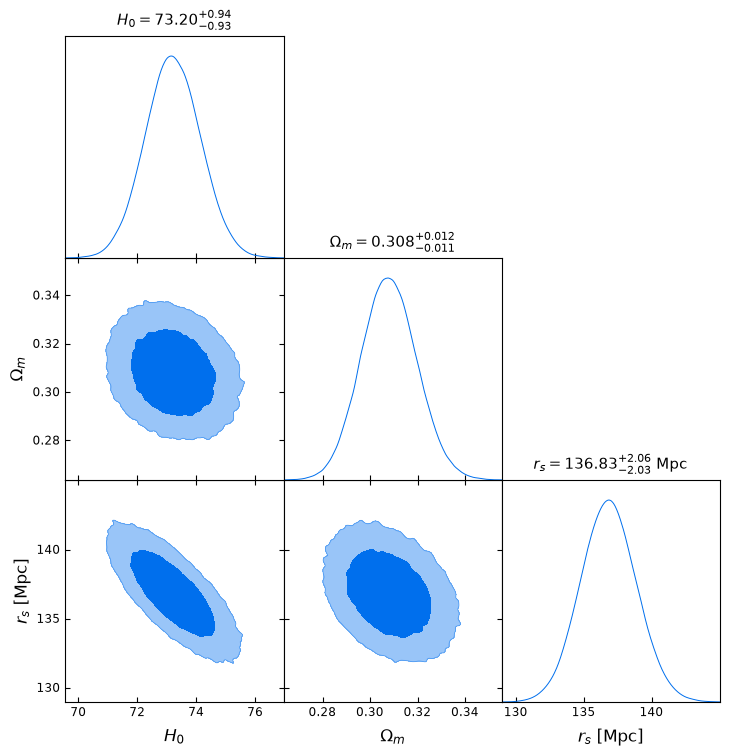
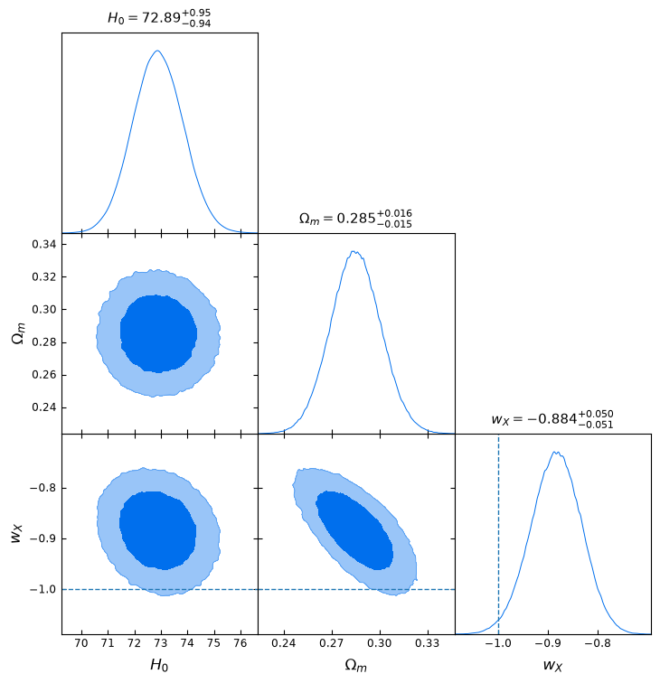
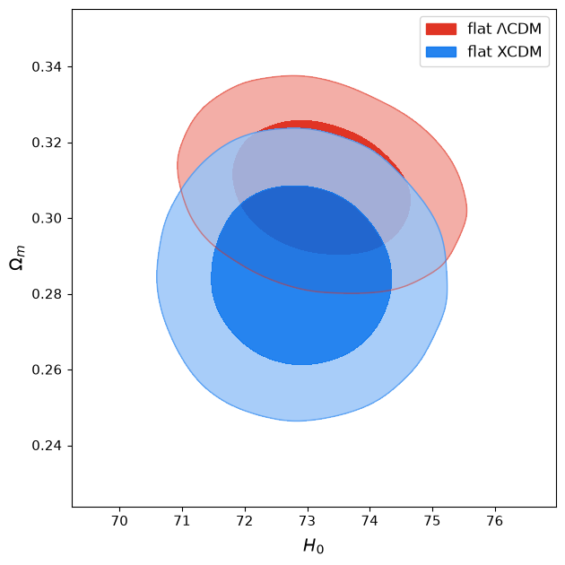
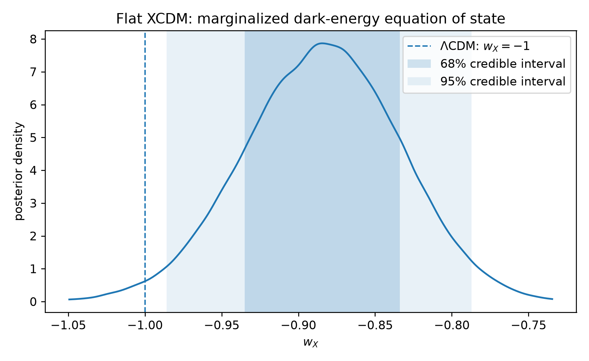
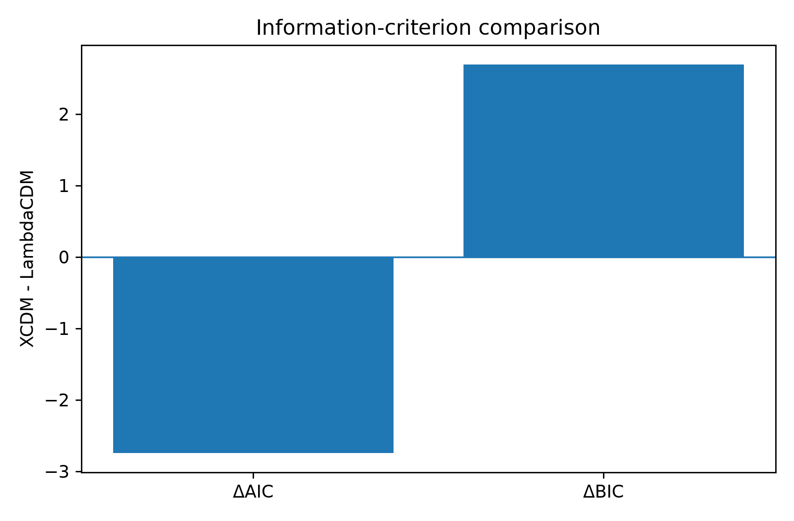

# Late-Time Cosmology Inference

A reproducible late-time cosmology analysis of spatially flat LambdaCDM and
XCDM using cosmic chronometers, baryon acoustic oscillations, Pantheon+, and
the calibrated Pantheon+SH0ES supernova sample.

The project reconstructs an earlier cosmological-parameter inference workflow
as a tested Python package with explicit covariance treatment, persistent local MCMC
backends, convergence diagnostics, publication-style posterior figures, and
model-comparison statistics.

## Data

Three late-time probes are used.

**Cosmic chronometers (CC).** The analysis uses a 32-point H(z) compilation.
Published correlated systematic covariance terms are included for the Moresco
subset rather than treating every point as statistically independent.

**Baryon acoustic oscillations (BAO).** The reduced BAO likelihood contains
11 measurements, including correlated BOSS DR12 and Ly-alpha blocks. BAO-only
fits are reported both in their calibration-independent form and, where
explicitly stated, with a fixed sound-horizon calibration.

**Pantheon+ and Pantheon+SH0ES.** The public Pantheon+ data vector and full
STAT+SYS covariance are used. Pantheon+ alone constrains relative distances,
while the SH0ES Cepheid-host information supplies the absolute calibration
needed for a direct H0 constraint.

## Cosmological models

The flat LambdaCDM expansion rate is

```math
E^2(z) = \Omega_m(1+z)^3 + (1-\Omega_m).
```

Flat XCDM replaces the cosmological constant with a homogeneous component
having a constant equation-of-state parameter w_X,

```math
E^2(z) =
\Omega_m(1+z)^3
+
(1-\Omega_m)(1+z)^{3(1+w_X)}.
```

The nested LambdaCDM limit is exactly

```math
w_X=-1.
```

Geometrized early-time ruler information is carried through the physical
baryon and cold-dark-matter densities and the sound horizon r_s.

## Full-data constraints

The primary comparison uses the same calibrated data combination in both
models:

```text
Pantheon+SH0ES + CC + BAO
```

The marginalized 68% credible intervals are:

| Model | H0 [km s^-1 Mpc^-1] | Omega_m | r_s [Mpc] | w_X |
| --- | ---: | ---: | ---: | ---: |
| flat LambdaCDM | $73.20^{+0.94}_{-0.93}$ | $0.308^{+0.012}_{-0.011}$ | $136.83^{+2.06}_{-2.03}$ | -1 (fixed) |
| flat XCDM | $72.89^{+0.95}_{-0.94}$ | $0.285^{+0.016}_{-0.015}$ | $136.49^{+2.08}_{-2.03}$ | $-0.884^{+0.050}_{-0.051}$ |

### Flat LambdaCDM



### Flat XCDM



The dashed reference at w_X=-1 marks the nested LambdaCDM model.

## Model comparison



For XCDM relative to LambdaCDM,

```math
\Delta\chi^2 = -4.746,
```

```math
\Delta\mathrm{AIC} = -2.746,
```

and

```math
\Delta\mathrm{BIC} = +2.693.
```

The additional XCDM parameter improves the minimum chi-square by
4.746. The approximate one-parameter nested
likelihood-ratio diagnostic gives p=0.029, corresponding
to sqrt(Delta chi-square)=2.18.

AIC therefore gives a mild preference to XCDM, while BIC gives a mild
preference to the simpler LambdaCDM model. The result is interpreted as a
mild preference for w_X greater than -1, not as decisive evidence for
dynamical dark energy.



The central 95% marginalized interval is

```math
-0.986 < w_X < -0.787.
```

The LambdaCDM value w_X=-1 lies just outside this central interval for the
specific likelihoods, calibrations, priors, and data compilation used here.



## Calibration notes

Several results in this repository intentionally answer different statistical
questions.

- Uncalibrated BAO constrains combinations such as Omega_m and r_s h; it does
  not determine H0 and r_s independently.
- A BAO H0 result obtained after fixing r_s is explicitly conditional on that
  ruler calibration.
- Pantheon+ supernovae alone constrain relative luminosity distances and do not
  independently determine H0.
- Pantheon+SH0ES includes Cepheid-host calibration and therefore breaks the
  supernova absolute-magnitude/H0 degeneracy.

These distinctions are preserved rather than forcing all data combinations
to return the same H0 value.

## Reconstruction notes

The present implementation was rebuilt from an earlier cosmological-inference
workflow rather than publishing the original scripts unchanged. Several
methodological points were made explicit during the reconstruction:

- the cosmic-chronometer likelihood uses the CC data vector with its appropriate
  correlated systematic covariance treatment;
- Pantheon+ relative-distance inference is kept distinct from the
  Pantheon+SH0ES calibrated likelihood used to constrain the absolute distance
  scale;
- BAO-only constraints are separated from results that assume an external or
  fixed sound-horizon calibration;
- AIC and BIC are evaluated from the maximum likelihood rather than from a mean
  MCMC likelihood;
- burn-in and chain adequacy are determined from measured autocorrelation times
  rather than fixed thinning or visually chosen cutoffs.

These changes make the numerical assumptions and calibration choices directly
auditable in the source code and tests.

## Numerical strategy

The inference pipeline uses NumPy/SciPy for background calculations and
likelihood evaluation, `emcee` for ensemble MCMC, and GetDist for marginalized
posterior visualization.

The production chains use persistent HDF5 backends. Burn-in is selected from
the measured integrated autocorrelation time, and production runs require
more than 50 autocorrelation times per sampled parameter.

The Pantheon+SH0ES likelihood uses the released full covariance matrix.
For repeated XCDM evaluations, its profiled likelihood is accelerated by a
validated interpolation cache. Exact likelihood evaluations are retained as
a fallback outside the cache region.

## Validation

The test suite checks, among other items,

- E(0)=1 for flat LambdaCDM;
- exact recovery of LambdaCDM from XCDM at w_X=-1;
- numerical-distance integration against independent quadrature;
- BAO covariance positive definiteness;
- reproduction of reference BAO best-fit points;
- CC covariance symmetry and off-diagonal systematic structure;
- analytic supernova nuisance-offset identities;
- Pantheon+SH0ES H0 scaling;
- sound-horizon consistency;
- all-data derived-parameter identities;
- LambdaCDM/XCDM model-comparison bookkeeping.

At the current publication checkpoint, 31 tests pass.

## Repository structure

```text
data/                     small analysis data and metadata
notebooks/                numbered research notebooks
scripts/                  data, audit, inference, and figure scripts
src/late_time_cosmology/  reusable likelihood and cosmology package
tests/                    physics and numerical regression tests
results/                  run summaries and generated analysis products
publication/              selected public-facing figures and README draft
```

## Reproducing the analysis

A local editable installation can be created with

```bash
python -m venv .venv
source .venv/bin/activate
python -m pip install --upgrade pip
python -m pip install -e ".[research,dev]"
```

The scientific regression tests are then run with

```bash
pytest -v
```

Representative production scripts include

```bash
python scripts/run_cc_flat_lcdm.py
python scripts/run_bao_flat_lcdm.py
python scripts/run_cc_bao_flat_lcdm.py
python scripts/run_pantheon_flat_lcdm.py
python scripts/run_pantheon_shoes_flat_lcdm.py
python scripts/run_all_flat_lcdm.py
python scripts/run_cc_bao_xcdm.py
python scripts/run_all_xcdm.py
python scripts/make_final_model_comparison.py
```

The larger Pantheon+ release products are obtained from the official
Pantheon+SH0ES public data release rather than treated as original data from
this repository.

## Scope

The repository is a late-time background-expansion analysis. XCDM is used as
a phenomenological constant-w_X background parametrization. It is not a
complete perturbation-level dark-energy model, and the present comparison is
not a Bayesian-evidence calculation.

The numerical results should therefore be interpreted within the stated data,
priors, covariance choices, sound-horizon prescription, and calibration
assumptions.

## References

The analysis follows and cross-checks the published Pantheon+, SH0ES, cosmic
chronometer, and H(z)+BAO literature. A BibTeX reference file is provided in `references.bib`.

## License

This project is released under the MIT License.
